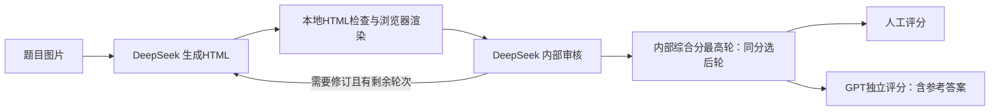

# Visualize Agent：题目交互式可视化与评测
把数学、物理、化学题图生成面向学生的交互式 HTML，保存逐轮修改、模型审核、人工评分、token 与耗时。当前研究重点是用 DeepSeek 完成生成流程，用独立 GPT judge 和人工评价比较不同 workflow。
**第一次看项目：先启动 benchmark，浏览已保存的结果，无需 API Key，也不会自动调用模型。**
## 1. 克隆后直接看结果
需要 Python 3.10+。以下命令从仓库根目录执行；Windows 推荐 WSL，单纯浏览 benchmark 也可直接用 Windows Python。
```bash
git clone -b experiment/ocr-multimodal https://github.com/RiaRrr/Visualize_Agent.git
cd Visualize_Agent
python3 -m venv .venv
source .venv/bin/activate
python -m pip install -r requirements-lock.txt
python -m uvicorn app.benchmark:standalone --host 127.0.0.1 --port 8002
```
Windows PowerShell 将创建/激活虚拟环境两行换成 `python -m venv .venv`、`.venv\Scripts\Activate.ps1`，后续命令相同。
若默认PyPI下载超时，可重试 `python -m pip install --timeout 60 -i https://pypi.tuna.tsinghua.edu.cn/simple -r requirements-lock.txt`；只影响本次安装，不修改全局源。
打开 **http://127.0.0.1:8002/benchmark**。这不是静态的 HTML 首页，不能直接双击 `web/benchmark.html`；它需要上面的本地服务提供题目与评分数据。生成的单个解题 HTML 则可以直接用浏览器打开。
页面包含：36道候选题及知识点、原题与参考解、交互式解题页面、五维人工评分与综合分、已有 GPT 评分理由、workflow 介绍。截图和已保存页面已随仓库提供，浏览不需要安装服务端 Chrome。
已保存的人工评分者编号是 `primary`。自己评分时在页面改用新的编号（如 `senior`），保留原始评分；修改会保存历史。服务默认只监听本机。
先读 [首批人工评分与成本汇总](benchmark/reports/分享汇总.md)，或者打开 [化学 W1 示例](http://127.0.0.1:8002/benchmark?sample=B50DFB016)。目录和完整操作说明见 [benchmark/README.md](benchmark/README.md)。
## 2. 当前包含哪些实验和数据
| 实验 | 数据与模型 | workflow / 状态 | 记录 |
| --- | --- | --- | --- |
| 原图与 OCR 对照 | 直角三角形等历史题；Qwen `qwen3.6-35b-a3b` 生成、`qwen3.6-flash` 识图/审核，另探索 DeepSeek 文本生成 | 原图直传 vs 一次题目OCR＋逐轮页面描述；已做，小样本，不能混入当前统一benchmark | [OCR对照实验](OCR对照实验.md)、[方案比较](方案比较.md) |
| 直接生成 vs 规划后生成 | 三角形、抛物线、双曲线/椭圆历史题；Qwen Flash、DeepSeek Flash，并跟进 260910/261017 型号 | 结构化解题/交互规划→核对→HTML；复杂题仍会出现数学或代码错误，规划不保证更好 | [数学可视化迁移实验](数学可视化迁移实验.md) |
| DeepSeek 原图改进 | 历史几何题；`deepseek-v4-1-flash-261017`，参考已有 GPT 页面可观察到的设计 | 尝试通用/强化规则、教学示例、SVG、固定模板、推理强度、局部补丁；GPT不在这批生成链路中 | [1019实验](1019.md) |
| 当前统一 benchmark pilot-v1 | 36道候选题中先用数理化各1道开发题；DeepSeek 261017生成与内部审核 | W0单轮、W1三轮整页修订、W2三轮局部修订；9任务、21轮HTML、9选中页面 | [benchmark说明](benchmark/README.md) |
| 当前独立评价 | 上述9份页面；`gpt-5.6-sol`＋用户人工评分 | 9份旧版GPT联合评分、9份人工评分均已保存；新的五维独立call＋综合call已实现，尚未重评 | [评分与费用](benchmark/reports/分享汇总.md)、[judge说明](benchmark/evaluation/README.md) |
历史模型ID和可用性是当时网关的实验记录，不保证其他账号或今天同名接口可用。历史使用过 GPT/Codex 页面作参考；当前benchmark生成、内部审核、修订全部是 DeepSeek，没有 GPT 生成费用混入。
仓库包含36道候选题的题图、原文、参考资料，以及当前pilot的21轮产物；另外归档了2道历史题的3份人工评分页面。完整历史 `data/`、`data_v2/`、`data_compare/` 和1875题的原始大题库不随仓库分发，历史报告里的本机历史路径不属于可直接打开的当前benchmark样本。
## 3. 流程与模型

生成提示词由 **通用可视化要求＋学科经验＋输入输出要求** 组成，均在 `app/prompts/`。普通工作台可自动分流数理化/其他，也支持显式选择学科、图片直传/OCR、规划生成和局部修订。
当前benchmark已知学科，直接使用学科提示，不额外调用分流或OCR；参考答案不进入生成与内部审核。W0也做一次内部审核用于记录，只是不返修。W1/W2固定3轮，即使提前通过也保存后续轮次。各组首轮独立生成，未共用随机种子或同一初稿，所以还不是完全消除随机性的修订实验。
独立GPT看原题、参考解、完整源码、页面截图和操作记录，不看人工评分，也不把意见反馈给生成流程。新judge将一致性、正确性、页面效果、交互效果、教学效果拆成5次互不传分的调用，综合分另1次。
## 4. 配置自己的 Key，生成新页面
只有重新生成/评测才需要模型账号；浏览随仓库提供的数据不需要。复制配置模板后填入自己的密钥：
```bash
cp .env.example .env
```
- DeepSeek：填写 `VISUALIZE_CODEX_KEY` 与 `VISUALIZE_CODEX_BASE_URL`，使用兼容的 Chat Completions 网关；实验的精确模型ID是 `deepseek-v4-1-flash-261017`，provider 为 `codex`（这里是接口配置名）。
- GPT judge：填写 `VISUALIZE_OPENAI_KEY` 与 `VISUALIZE_OPENAI_BASE_URL`，后者必须换成你可用的 Responses 兼容地址；模型配置在 `benchmark/evaluation/judge_registry.json`。
- `.env`、真实密钥、本机历史目录均被Git忽略。系统环境变量优先于`.env`。示例地址和模型不是免费公共服务，访问权限由自己的网关账号决定。
生成和重新截图需要 Linux/WSL 中已安装 Chrome/Chromium，且命令 `google-chrome`、`chromium` 或 `chromium-browser` 至少一个在 PATH；浏览已有页面不需要这个服务端依赖。使用有图形浏览器权限的普通用户启动。
启动完整上传工作台：
```bash
python -m uvicorn app.main:app --host 127.0.0.1 --port 8001
```
打开 http://127.0.0.1:8001 ，上传图片，选择模型、学科提示与轮次。模板默认将新数据写入相对目录 `data_local/`。手动选择 DeepSeek 和图片直传；模型下拉只将已通过历史图片测试的入口列为识图可用。模型目录可查询，但不会自动跑短识图测试，测试按钮仅在点击时调用。
默认单轮与完整迭代/固定五轮可切换；普通迭代通过即停，达到上限仍未通过时保留最佳草稿。原图、每轮HTML、截图、审核和配置快照按时间戳保存，任务页可切轮、看日志、看每轮与整个任务的token和耗时。
批量benchmark运行及单样本重评命令见 [benchmark/README.md](benchmark/README.md)。不要为浏览已有结果运行生成脚本。
## 5. 人民币成本口径
用户确认的价格，单位为人民币／百万token（MTok），不是缓存读写价：
| 模型 | 输入 | 输出 |
| --- | ---: | ---: |
| deepseek-v4-1-flash-261017 | ¥1.20 | ¥4.80 |
| gpt-5.6-sol | ¥5.00 | ¥30.00 |
估算 = 输入token×输入价/百万＋输出token×输出价/百万。缓存token属于输入子项，推理token属于输出子项，不重复加价；暂不另设缓存折扣。模型价格取自用户提供的信息，估算不代表网关账单。
首批DeepSeek已知1,620,461 token，约¥6.0857；GPT旧评分259,160 token，约¥1.6678；合计已知1,879,621 token、约**¥7.7535**。另有16次失败调用未返回usage，未算入价格，不当作免费。新六次judge尚未运行。
## 6. 仓库结构
| 路径 | 内容 |
| --- | --- |
| `app/` | FastAPI、模型调用、生成审核流程、存储、浏览器渲染 |
| `app/prompts/` | 生成、审核、教学效果、学科与格式提示 |
| `web/` | 上传工作台与benchmark浏览/评分界面 |
| `benchmark/` | 36题、当前实验快照、逐轮HTML、人工与模型评分、报告 |
| `scripts/` | 实验运行、准备题库、评分、无模型调用的数据汇总 |
| `tests/` | 调用协议、评分、存储、批处理及成本等测试 |
| `docs/reports/` | 阶段工作汇报；根目录日期/实验文档保留探索过程 |
| `.env.example` | 可复制的无密钥配置模板 |
`requirements-lock.txt` 固定了本次干净环境验收使用的依赖版本；`requirements.txt` 保留开发时允许的版本范围。验收步骤与边界见 [验收清单](docs/验收清单.md)。
## 7. 测试与下一步
```bash
python -m pytest -q
node --test tests/test_cost_display.cjs
```
Python测试使用mock，不发起付费模型调用。Node命令只用于前端费用计算测试，启动服务不需要Node。
下一步：冻结新judge版本，在已有人评分页面上检验逐维评分是否更接近人工；再扩展开发题、按题而非HTML划分校准/验证，比较同题多次运行的质量与费用；最后才在留出集做最终检验。当前只有3道独立试运行题，尚不能判断哪种workflow最好。
